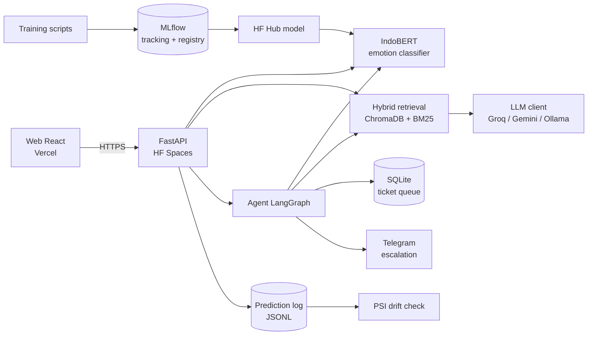

# Indo Review Intelligence

Sistem hybrid yang menggabungkan **emotion classifier** (fine-tuned IndoBERT)
dengan **RAG + LLM** untuk menghasilkan insight otomatis dari review aplikasi
Indonesia (domain: Halodoc, Gojek, dsb).

Klasifikasi emotion 3-kelas — `anger`, `happiness`, `sadness` (tanpa kelas netral) —
dipadukan dengan retrieval-augmented generation untuk merangkum keluhan pengguna
dan menjawab pertanyaan tim produk berbasis data review nyata.

## Demo live

- **API (Swagger / OpenAPI):** [https://riezqidr-indo-emotion-classifier.hf.space/docs](https://riezqidr-indo-emotion-classifier.hf.space/docs)
- **Health check:** [https://riezqidr-indo-emotion-classifier.hf.space/health](https://riezqidr-indo-emotion-classifier.hf.space/health)
- **Hugging Face Space:** [riezqidr/indo-emotion-classifier](https://huggingface.co/spaces/riezqidr/indo-emotion-classifier)

> Space gratis bisa *sleep*; request pertama setelah idle butuh ±30–60 detik (cold start).

## Arsitektur



## Hasil

| Area | Metrik | Hasil | Detail |
| --- | --- | --- | --- |
| Classifier — baseline TF-IDF + LogReg | F1-macro (test) | **0.752** | `EXPERIMENTS.md` Fase 2 |
| Classifier — IndoBERT fine-tuned (di-serve) | F1-macro (test) | 0.726 | kalah tipis dari baseline di kelas `anger` |
| RAG retrieval (golden set) | hit@1 / MRR | 1.0 / 1.0 | [`reports/rag_eval_report.md`](reports/rag_eval_report.md) |
| RAG chat end-to-end | groundedness (LLM-as-judge) | 4.80 / 5 | idem |
| Agent routing (n=548) | akurasi cabang / escalation precision | 0.827 / 0.837 | [`reports/agent_eval_report.md`](reports/agent_eval_report.md) |
| Agent routing | escalation recall | 0.406 | bottleneck: classifier mengira `anger` sebagai `sadness` |

Temuan bahwa baseline klasik mengungguli IndoBERT dan bahwa recall eskalasi
dibatasi classifier (bukan threshold router) dibahas di `EXPERIMENTS.md`.

## Fitur

- **Classifier:** klasifikasi emosi review (IndoBERT fine-tuned) dengan baseline
  TF-IDF + Logistic Regression sebagai pembanding.
- **Insight generator:** ringkasan terstruktur (tema keluhan, kutipan, rekomendasi)
  dari review beremosi negatif, di-grounding ke data dan di-cache.
- **Chatbot internal:** menjawab pertanyaan bebas dengan grounding ke review
  ter-retrieve (anti-halusinasi) dan menyertakan sumber yang bisa dibaca.
- **Klasifikasi batch:** unggah CSV/TXT (maks. 100 review) → sebaran emosi +
  hasil per review yang bisa diunduh.
- **Monitoring live:** ringkasan prediksi + status drift (PSI) di tab Monitoring
  dan pengecekan mingguan lewat GitHub Actions.
- **Agentic layer (LangGraph):** classifier jadi salah satu _tool_ dalam state
  graph yang me-_route_ review (eskalasi / draft empati / arsip) berdasarkan
  confidence, membuat draft balasan yang di-_grounding_ ke RAG, dan menyimpan ke
  antrean untuk approval manusia (human-in-the-loop) + notifikasi eskalasi.
- **Experiment tracking:** MLflow (metrik utama F1-macro, confusion matrix, registry).
- **LLM provider-agnostic:** Groq / Gemini / Ollama lewat satu interface.

## Tech Stack

| Layer         | Tools                                        |
| ------------- | -------------------------------------------- |
| Preprocessing | pandas, scikit-learn                         |
| Model         | HuggingFace Transformers (IndoBERT), PyTorch |
| Tracking      | MLflow (SQLite backend)                      |
| Vector store  | ChromaDB                                     |
| Embedding     | sentence-transformers (multilingual MiniLM)  |
| LLM           | Groq / Gemini / Ollama                       |
| Agent         | LangGraph (state machine) + SQLite queue     |
| API           | FastAPI                                      |
| Frontend      | React + Vite (Fase 5)                        |

## Struktur Repo

```
.
├── configs/            # konfigurasi pipeline (data.yaml, training.yaml, rag.yaml)
├── data/processed/     # output pipeline data (train/val/test.csv)
├── Dataset/            # sumber data emotion (CSV)
├── src/
│   ├── data/           # cleaning, normalisasi label, build dataset
│   ├── training/       # baseline & fine-tuning IndoBERT, metrik
│   ├── tracking/       # helper MLflow + model registry
│   ├── rag/            # embedding, vector store, insight & chat
│   ├── llm/            # LLM client (Groq/Gemini/Ollama) + prompt
│   ├── agent/          # agentic layer LangGraph (state, router, nodes, graph, queue)
│   ├── api/            # FastAPI app (Fase 4) + endpoint /agent (Fase 6)
│   └── monitoring/     # logging prediksi + drift check (PSI)
├── reports/            # drift, RAG eval, dan agent routing eval report
├── tests/              # unit test
└── web/                # frontend React (Vite + Tailwind)
```

## Setup

Proyek menggunakan Python 3.11 (contoh: conda env `trading`).

```bash
pip install -r requirements.txt
cp .env.example .env          # isi API key LLM (Groq/Gemini)
cp web/.env.example web/.env
```

## Penggunaan

### 1. Pipeline data

```bash
python -m src.data.prepare_dataset --config configs/data.yaml
```

Membersihkan teks (normalisasi slang Indo, emoji), menyatukan label, dedup, dan
split train/val. Output: `data/processed/{train,val,test}.csv` (kolom `text,label`).

### 2. Training & tracking

```bash
python -m src.training.baseline --config configs/training.yaml        # TF-IDF + LogReg
python -m src.training.train_indobert --config configs/training.yaml  # IndoBERT
python -m src.tracking.registry --register                            # daftarkan model terbaik
mlflow ui --backend-store-uri sqlite:///mlflow.db                     # dashboard eksperimen
```

Metrik utama F1-macro (dataset imbalanced). Tambahkan `--max-train-samples`/`--epochs`
untuk smoke test cepat.

### 3. RAG (insight & chat)

```bash
python -m src.rag.build_index --config configs/rag.yaml --reset  # embed review ke ChromaDB
python -m src.rag.evaluate_retrieval                             # eval kualitas retrieval
```

Retrieval bersifat **hybrid**: vector search (ChromaDB + multilingual MiniLM)
digabung BM25 lexical via Reciprocal Rank Fusion — kata kunci eksak ("dana",
"voucher") tetap tertangkap meski embedding meleset. Query dinormalisasi dengan
preprocessing yang sama dengan korpus (slang Indo, emoji). Gerbang relevansi
chat (`min_score` 0.55) dikalibrasi dari golden set
(`configs/retrieval_eval.yaml`): hit@1 1.0, dan query di luar domain ditolak.

Insight & chatbot diakses lewat `InsightGenerator` / `ChatResponder`
(`src/rag/`) — keduanya di-cache (TTL) dan jawaban chat menyertakan hanya
review ID yang benar-benar dikutip. Chat mendukung riwayat percakapan
(multi-turn) lewat field `history`. Pilih provider LLM via `LLM_PROVIDER` di
`.env`. Retrieval berjalan tanpa API key; generasi insight/chat memerlukan key
LLM.

### 4. API (FastAPI)

```bash
uvicorn src.api.main:app --host 0.0.0.0 --port 7860
```

Endpoint:

| Method | Path        | Fungsi                                                          |
| ------ | ----------- | --------------------------------------------------------------- |
| GET    | `/health`   | Status model, vector DB, LLM provider                           |
| GET    | `/stats`    | Statistik dataset (distribusi emosi, per-split) untuk dashboard |
| POST   | `/classify` | `{text}` → `{label, confidence, probabilities}`                 |
| POST   | `/classify/batch` | `{texts[]}` (maks. 100) → hasil per teks + `by_emotion` (rate-limited) |
| POST   | `/insight`  | `{query, emotions?}` → ringkasan terstruktur (rate-limited)     |
| POST   | `/chat`     | `{question}` → `{answer, sources}` (rate-limited)               |
| POST   | `/reviews/lookup` | `{ids[]}` (maks. 50) → teks + emosi review yang dikutip sebagai sumber |
| GET    | `/monitoring/summary` | Ringkasan log prediksi live + status drift (PSI) vs data training |

`emotions` di `/insight` adalah filter kategori (`anger` / `sadness`); filter
periode tidak tersedia karena dataset tidak punya timestamp.

**Mode terdegradasi:** jika panggilan LLM gagal, `/insight` dan `/chat` tidak
mengembalikan 503 melainkan review hasil retrieval apa adanya dengan
`degraded: true` — tetap berbasis data nyata, tanpa ringkasan buatan.

Docs interaktif tersedia di `/docs`. CORS dan rate limit dikonfigurasi via env
(`CORS_ALLOW_ORIGINS`, `RATE_LIMIT_PER_MINUTE`). Build image: `docker build -t indo-review-api .`

### 5. Agentic layer (Fase 6)

Melapisi classifier pasif dengan **agent** berbasis LangGraph. Alih-alih hanya
mengembalikan label, agent membuat keputusan dan bertindak:

```
START → classify → route_by_emotion ─┬─ escalate  (anger, confidence tinggi) ─┐
                                     ├─ draft     (negatif lain → draft empati) ├─ END
                                     └─ archive   (positif → arsip)             ┘
```

- **Router (`src/agent/router.py`)** — keputusan inti: `anger` dengan confidence
  ≥ ambang (`escalate_min_confidence`, default 0.75) di-**eskalasi**; emosi
  negatif lain dibuatkan **draft**; positif di-**arsip**. Label tak dikenal
  jatuh ke `draft` (selalu dilihat manusia). Ambang & label diatur di
  `configs/agent.yaml`, bukan hardcode.
- **Draft ter-grounding** — node escalate/draft me-retrieve review serupa lewat
  RAG hybrid yang sudah ada, lalu LLM menulis draft **hanya** dari konteks itu
  (anti-halusinasi). Gagal LLM → fallback draft aman, bukan crash.
- **Human-in-the-loop** — tiap run disimpan sebagai tiket `pending` di SQLite
  (`agent_queue.db`); reviewer approve/reject sebelum draft "dikirim".
- **Notifikasi eskalasi** — Telegram bot bila `TELEGRAM_BOT_TOKEN` +
  `TELEGRAM_CHAT_ID` di-set, jika tidak fallback ke log file
  (`data/monitoring/escalations.log`).

| Method | Path                   | Fungsi                                              |
| ------ | ---------------------- | --------------------------------------------------- |
| POST   | `/agent/run`           | `{review_text}` → jalankan graph, simpan tiket (rate-limited) |
| GET    | `/agent/queue`         | List tiket (filter `?status=pending\|approved\|rejected`)     |
| POST   | `/agent/approve/{id}`  | 🔒 Setujui draft → kirim notifikasi                 |
| POST   | `/agent/reject/{id}`   | 🔒 `{reason}` → tolak draft, catat alasan           |
| POST   | `/agent/edit/{id}`     | 🔒 `{draft}` → ganti draft tiket yang masih `pending` |
| GET    | `/agent/stats`         | Metrik antrean (escalation count, approval rate)    |
| GET    | `/agent/notify-test`   | 🔒 Kirim pesan uji Telegram + diagnosis pengiriman  |

🔒 = aksi reviewer, wajib header `X-API-Key` yang cocok dengan env `AGENT_API_KEY`.
Sifatnya *fail-closed*: jika `AGENT_API_KEY` kosong, endpoint itu mengembalikan
503 (bukan terbuka untuk publik). Endpoint lain tetap publik untuk demo;
`/agent/run` dibatasi rate limit karena memanggil LLM. Di tab **Agent Queue**,
reviewer memasukkan key di kolom "API key reviewer" (disimpan per tab saja).

```bash
python -c "import secrets; print(secrets.token_urlsafe(32))"   # buat AGENT_API_KEY
```

Konfigurasi via `configs/agent.yaml` (threshold router, `top_k` grounding, path
queue) dan env (`AGENT_CONFIG`, `AGENT_QUEUE_DB`, `TELEGRAM_*`). LangGraph
opsional saat runtime: jika paket tak tersedia, agent otomatis fallback ke
eksekutor sekuensial ekuivalen (graceful degradation).

**Evaluasi routing** (offline, tanpa LLM — gratis & reproducible):

```bash
python -m src.agent.evaluate_agent --config configs/agent.yaml
```

Mengklasifikasi seluruh test set dengan IndoBERT asli, me-route dengan threshold
dari config, lalu membandingkan dengan cabang untuk label manusia: akurasi
cabang, precision/recall eskalasi, *missed-negative rate* (review negatif yang
terarsip), sweep threshold, dan latency. Output: `reports/agent_eval_report.md`.

**Keterbatasan yang disengaja:** antrean tiket memakai SQLite lokal. Di HF
Spaces free tier disk container tidak persisten, sehingga tiket hilang saat
Space restart/redeploy. Untuk demo ini cukup; untuk produksi pindahkan
`AGENT_QUEUE_DB` ke persistent storage (HF Spaces `/data`) atau Postgres.

## Frontend (web/)

Aplikasi React + Vite dengan 6 tab: Dashboard (distribusi emosi), Coba Klasifikasi
(satu review atau unggah CSV/TXT hingga 100 review, hasil bisa diunduh), Insight
(dengan filter emosi), Tanya Data (chat), **Agent Queue** (demo agent, edit draft,
approval tiket), dan **Monitoring** (prediksi live + status drift). Di Insight,
Chat, dan Agent Queue, sumber/grounding bisa dibuka untuk membaca teks review
aslinya, bukan hanya ID.

```bash
cd web
npm install
npm run dev      # http://localhost:5173
npm run build    # output ke web/dist
```

Set `VITE_API_BASE_URL` (lihat `web/.env.example`) ke URL backend.

## Monitoring

Setiap prediksi `/classify` otomatis di-log (timestamp, teks, label, confidence)
ke JSONL — path via env `PREDICTION_LOG_PATH` (default
`data/monitoring/predictions.jsonl`), ditulis non-blocking setelah response.

**Live:** `GET /monitoring/summary` merangkum log itu (jumlah prediksi, sebaran
label, confidence, volume harian) dan membandingkannya dengan data training
(`DRIFT_REFERENCE_CSV`). Verdict drift baru dihitung setelah ≥30 prediksi — PSI
atas sampel kecil tidak bermakna. Hasilnya tampil di tab **Monitoring**; teks
review di log tidak pernah dikirim ke klien.

**Terjadwal:** `.github/workflows/drift-check.yml` menarik ringkasan yang sama
tiap Senin dan menggagalkan run jika verdict `DRIFT`. Workflow memakai secret
`HF_SPACE_URL` sebagai base URL API (mis. `https://<user>-<space>.hf.space`).
Catatan: log prediksi di HF Spaces free tier hilang saat Space restart, jadi
jendela pengamatannya hanya sejak restart terakhir.

Drift check juga bisa dijalankan manual:

```bash
python -m src.monitoring.check_drift              # log prediksi vs train.csv
python -m src.monitoring.check_drift --simulate   # demo: sample sengaja drifted
```

Metrik: **PSI** distribusi label & panjang teks (ambang 0.1 moderat / 0.2 drift)
plus porsi prediksi low-confidence. Report markdown ditulis ke
`reports/drift_report.md` (contoh hasil simulasi ter-commit di repo).

## Testing & Linting

```bash
pytest -q --cov=src          # 150+ test, semua dependency eksternal (LLM, Telegram) di-mock
ruff check src tests
cd web && npm run lint && npm run build
```

## Deployment

Arsitektur: **API** di Hugging Face Spaces (Docker), **web** di Vercel. Model
classifier di-pull dari HF Hub; index ChromaDB di-bake ke image saat build dari
`Dataset/` (cold start cepat).

### 1. Publikasikan model ke HF Hub

```bash
huggingface-cli login
python -m scripts.push_model_to_hub --repo <username>/indo-emotion-indobert
```

### 2. API → Hugging Face Spaces (Docker SDK)

1. Buat Space baru → SDK **Docker**.
2. Push isi repo ini ke Space (atau hubungkan dari GitHub). `Dockerfile` di root
   otomatis dipakai; index ChromaDB dibuild saat image build.
3. Tambahkan frontmatter di README Space (atau set di UI): `app_port: 7860`.
4. Isi **Settings → Variables & secrets**:
   - `MODEL_DIR` = `<username>/indo-emotion-indobert`
   - `LLM_PROVIDER` = `groq` (atau `gemini`)
   - `GROQ_API_KEY` / `GEMINI_API_KEY`
   - `CORS_ALLOW_ORIGINS` = URL Vercel (mis. `https://namaapp.vercel.app`)
   - `AGENT_API_KEY` = key reviewer (tanpa ini approve/reject mengembalikan 503)
   - `TELEGRAM_BOT_TOKEN` + `TELEGRAM_CHAT_ID` (opsional, notifikasi eskalasi)
5. Tunggu build selesai, verifikasi `https://<space>.hf.space/health`.

### 3. Web → Vercel

1. Import repo, set **Root Directory** = `web/` (`web/vercel.json` sudah ada).
2. Env var: `VITE_API_BASE_URL` = URL Space (mis. `https://<space>.hf.space`).
3. Deploy, lalu smoke test: Dashboard → Classify → Insight → Chat.

### 4. CI & otomasi HF Spaces

- `.github/workflows/ci.yml` — lint (ruff) + test backend dengan coverage gate
  (≥65%), lint + build frontend, di setiap push ke branch mana pun dan PR ke
  `main`/`dev`.
- `.github/workflows/sync-to-hf.yml` — deploy ke Space **hanya setelah CI hijau**
  di `main` (`workflow_run`), mem-push commit persis yang sudah dites. Bisa juga
  manual via Actions tab.
- `.github/workflows/keep-alive.yml` — ping Space tiap 6 jam agar tidak sleep
  (free tier HF Spaces tidur setelah ~48 jam tanpa traffic).

Secret yang harus di-set di GitHub (**Settings → Secrets and variables →
Actions**):

| Secret          | Isi                                                                                |
| --------------- | ---------------------------------------------------------------------------------- |
| `HF_TOKEN`      | Token HF dengan akses write (https://huggingface.co/settings/tokens)               |
| `HF_SPACE_URL`  | URL health Space, mis. `https://riezqidr-indo-emotion-classifier.hf.space/health`  |

> Catatan: workflow `schedule` (keep-alive) hanya berjalan dari branch default
> (`main`) — pastikan workflow sudah ter-merge ke `main` di GitHub.

Frontmatter HF Spaces (`sdk: docker`, `app_port: 7860`) sudah ada di bagian atas
README ini, jadi Space langsung terkonfigurasi saat sync.

> Uji lokal image: `docker build -t indo-review-api . && docker run -p 7860:7860 -e MODEL_DIR=<username>/indo-emotion-indobert -e GROQ_API_KEY=... indo-review-api`

## Dataset

Emotion classification 3-kelas (`anger`, `happiness`, `sadness`) dari review
aplikasi Indonesia. Dataset imbalanced (kelas `anger` minoritas); penanganannya
memakai class weighting dan evaluasi berbasis F1-macro.

Ukuran CSV mentah ±300 KB, jadi saat ini di-track langsung di git (bukan DVC);
alasannya dicatat di `EXPERIMENTS.md`.

## Lisensi

Kode dirilis di bawah [MIT License](LICENSE). Dataset review mengikuti ketentuan
sumber aslinya dan tidak termasuk dalam lisensi ini.